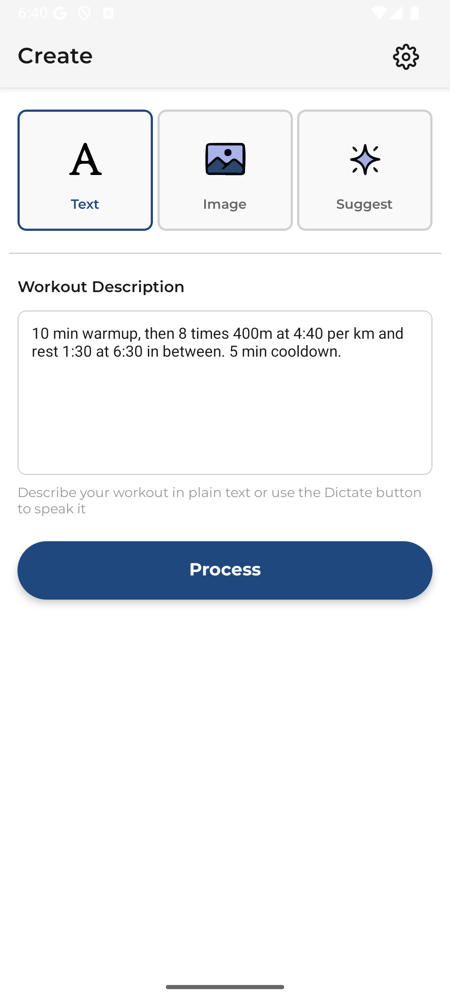
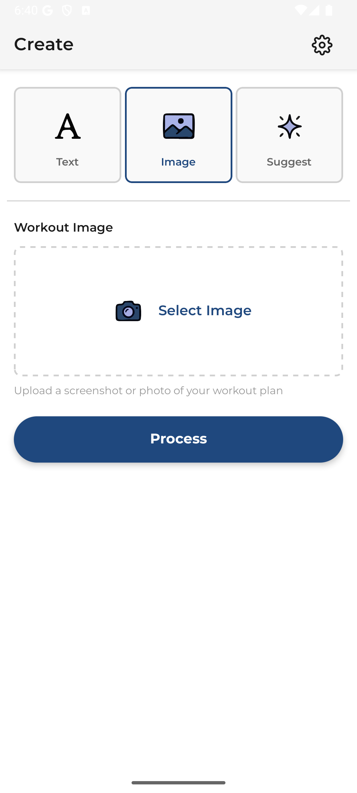
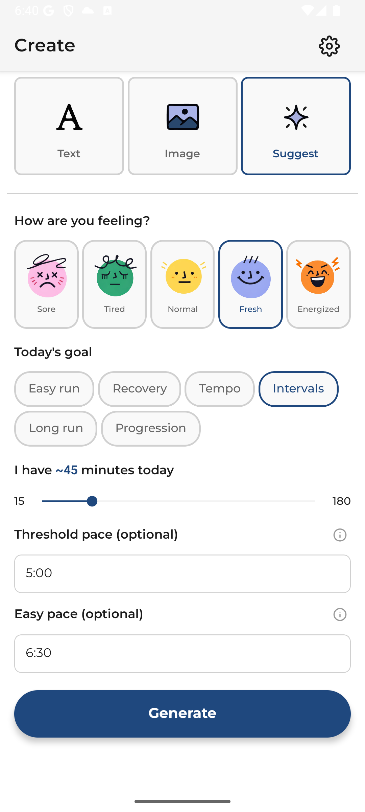
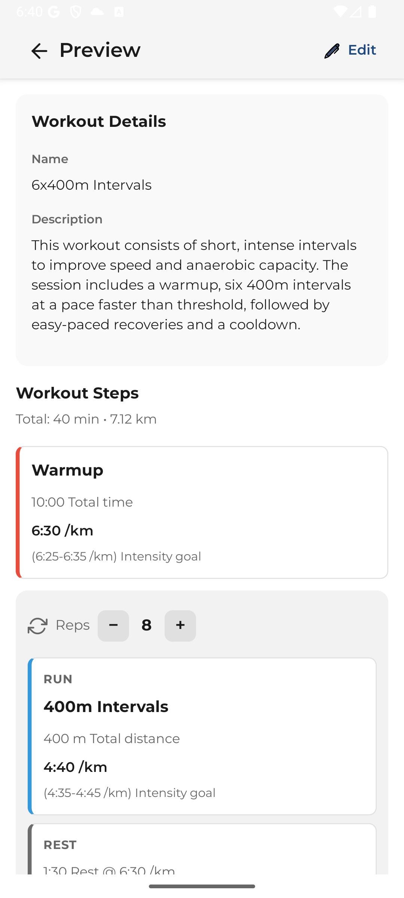
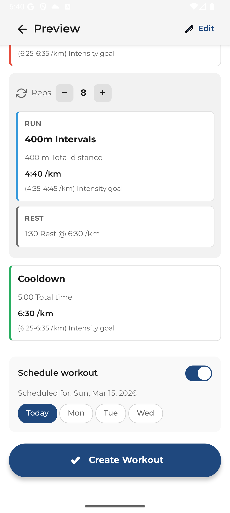

# AI Run Workout Builder (Garmin Connect)

I built this small utility app for myself to turn free‑text (or images) into structured **Garmin run workouts** - intervals with distance, time, and pace - then push them to **Garmin Connect** for your watch. Alternatively, it lets you enter how you feel and AI create a running workout for you based on the inputs.
Maybe also other runners find it useful:

[Get it on Google Play](https://play.google.com/store/apps/details?id=com.garminworkouts.app)

|                                 Text input                                  |                                  Image input                                  |                                     Suggest                                      |
| :-------------------------------------------------------------------------: | :---------------------------------------------------------------------------: | :------------------------------------------------------------------------------: |
|  |  |  |

|                                                                                  Preview and edit                                                                                   |
| :---------------------------------------------------------------------------------------------------------------------------------------------------------------------------------: |
|   |

The app is **free to use** and the project is **open source**. If it helps your training and you would like to chip in toward API and server costs, you can **[buy me a coffee](https://buymeacoffee.com/maidi)** - every contribution is appreciated.

Garmin access uses **unofficial**, community-documented Connect behavior (not a public product API). The token flow follows the same ideas as [garth](https://github.com/cyberjunky/garth) and [python-garminconnect](https://github.com/cyberjunky/python-garminconnect). The user signs in directly on Garmin's site inside an in-app WebView; the backend only exchanges the resulting CAS ticket for OAuth2 tokens (`backend/src/services/garminService.ts`). Passwords never reach the backend; tokens live on the device in secure storage.

Stack: **Expo (React Native)** + **Express** backend. AI runs on the server; Garmin sign-in happens on-device, and the backend handles only the OAuth ticket exchange.

## How it works

1. Sign in via the in-app Garmin WebView (`app/screens/GarminLoginWebView.tsx`). Garmin redirects to `…/embed?ticket=ST-…` after a successful login (MFA included).
2. The app posts that ticket to the backend, which exchanges it for OAuth2 tokens (`backend/src/services/garminService.ts`).
3. Describe a workout (text, image, voice-to-text, or guided "generate from context").
4. Backend calls **OpenAI**; you review or edit the result.
5. The app submits **Garmin JSON** to `https://connectapi.garmin.com` (Bearer token on device).

## Architecture

The backend is stateless: it exchanges a CAS ticket for OAuth2 tokens, returns them to the app, and forgets them. The app stores tokens in **expo-secure-store**; refresh is also proxied through the backend because the Connect Mobile refresh endpoint requires OAuth1 consumer-secret signing (which the device doesn't have). Workout create/list/schedule use the **Garmin Connect Mobile–style API** from the app (`api/client.ts`). AI routes require a valid Garmin access token and (in production) a shared **`APP_API_KEY`**.

```text
App (WebView) ──login on sso.garmin.com──► captures CAS ticket
App ──POST /api/garmin/exchange-ticket (ticket)──► Backend ──► Garmin OAuth
App ──POST /api/ai/* (Garmin Bearer + X-API-Key)──► Backend ──► OpenAI
App ──Bearer───────────────────────────────────────► connectapi.garmin.com (workouts)
```

### Background - why login moved on-device

The original flow ran login entirely on the backend, modeled on [garth](https://github.com/cyberjunky/garth) and [python-garminconnect](https://github.com/cyberjunky/python-garminconnect): the server fetched Garmin's SSO embed page, scraped the CSRF token, POSTed credentials, parsed the CAS ticket out of the response, then exchanged that ticket for OAuth1 → OAuth2 tokens. Around March 2026 Garmin / Cloudflare started returning **403** to SSO POSTs originating from datacenter IPs (Fly, Railway, Vercel, etc.) regardless of User-Agent spoofing or mobile-app headers. The breakage is documented across the upstream libraries - see [garth issues](https://github.com/cyberjunky/garth/issues) and [python-garminconnect issues](https://github.com/cyberjunky/python-garminconnect/issues) for ongoing reports.

The current flow keeps the OAuth1 → OAuth2 token exchange from those libraries (the `connectapi.garmin.com` OAuth endpoints aren't behind the Cloudflare SSO rule, so server-to-server still works there) but moves the login itself on-device, where the request comes from a residential connection Cloudflare doesn't block. The Expo app loads `sso.garmin.com/sso/signin` in a `WebView` (`app/screens/GarminLoginWebView.tsx`), the user signs in directly with Garmin (MFA included), and the app intercepts the post-login redirect to `…/embed?ticket=ST-…`. The backend's remaining job is exchanging that ticket for OAuth2 tokens (`backend/src/services/garminService.ts`) and proxying refresh - both still require OAuth1 consumer-secret signing, which can't live on a public mobile build.

**Backend routes**

- `POST /api/garmin/exchange-ticket` - body `{ ticket }` (CAS ticket from the SSO redirect). Returns access/refresh tokens, user id, display name. Rate-limited per IP.
- `POST /api/garmin/refresh-token` - body `{ refresh_token }`. Returns new access/refresh tokens. Rate-limited per IP.
- `POST /api/ai/generate-from-context`, `process-text-multiple`, `process-image-multiple` - require `Authorization: Bearer <Garmin access token>` and (in production) `X-API-Key` (`backend/src/middleware/aiAuth.ts`). Bodies validated with Zod (`backend/src/validation/`). Rate limits apply per IP and per Garmin user (see `API_REFERENCE.md`).

**App**

- `hooks/useAuth.ts` - token lifecycle, 401 retry on `apiClient`.
- `services/garminAuthService.ts` - secure storage and refresh (refresh is proxied through the backend).
- `app/screens/GarminLoginWebView.tsx` - in-app WebView that captures the CAS ticket from the SSO redirect.
- `hooks/useAI.ts` / `hooks/useWorkout.ts` - AI extraction and Garmin submission.

Details: [GARMIN_JSON_SPEC.md](GARMIN_JSON_SPEC.md) (workout JSON), [API_REFERENCE.md](API_REFERENCE.md) (HTTP API).

## Quick start

### Setup

```bash
npm install
cd backend && npm install && cd ..

cp .env.example .env
cp backend/.env.example backend/.env
```

**Frontend `.env`** - `EXPO_PUBLIC_BACKEND_URL`, optional `EXPO_PUBLIC_APP_API_KEY` (must match backend).

**Backend `.env`** - `OPENAI_API_KEY`, `GARMIN_OAUTH_CONSUMER_KEY`, `GARMIN_OAUTH_CONSUMER_SECRET`, optional `CORS_ORIGIN`, `APP_API_KEY` (required when `NODE_ENV=production`).

### Run

```bash
# Terminal 1
cd backend && npm run dev

# Terminal 2
npm start
# Then iOS simulator, Android emulator, or Expo Go
```

## Deployment

### Backend (Fly.io)

Copy `backend/fly.toml.example` to `backend/fly.toml` and set `app` to your own Fly.io app name (the real `fly.toml` is gitignored). Set secrets to match your environment; **production** requires **`APP_API_KEY`** (see `assertProductionSecrets` in `backend/src/config/env.ts`).

```bash
cd backend

fly secrets set \
  OPENAI_API_KEY="..." \
  GARMIN_OAUTH_CONSUMER_KEY="..." \
  GARMIN_OAUTH_CONSUMER_SECRET="..." \
  APP_API_KEY="..." \
  NODE_ENV="production" \
  CORS_ORIGIN="*"

fly deploy
```

Adjust `CORS_ORIGIN` for real app origins in production if you do not intend to allow all.

### Frontend (EAS)

`eas.json` defines build profiles. Set **`EXPO_PUBLIC_BACKEND_URL`** and **`EXPO_PUBLIC_APP_API_KEY`** per EAS environment.

```bash
eas env:create --name EXPO_PUBLIC_BACKEND_URL --value "https://your-backend.fly.dev" --environment production --visibility sensitive
eas env:create --name EXPO_PUBLIC_APP_API_KEY --value "<same-as-APP_API_KEY>" --environment production --visibility sensitive
```

Generate a key, for example: `openssl rand -hex 32`

```bash
eas build --platform android --profile preview
eas build --platform android --profile production
```

### Where backend URL comes from

| Context    | Backend URL             | Typical source |
| ---------- | ----------------------- | -------------- |
| Local dev  | `http://<host-ip>:3000` | `.env`         |
| EAS builds | Your deployed Fly URL   | EAS env vars   |

## Documentation

- [API_REFERENCE.md](API_REFERENCE.md) - Backend endpoints and auth
- [GARMIN_JSON_SPEC.md](GARMIN_JSON_SPEC.md) - Garmin workout payload reference
